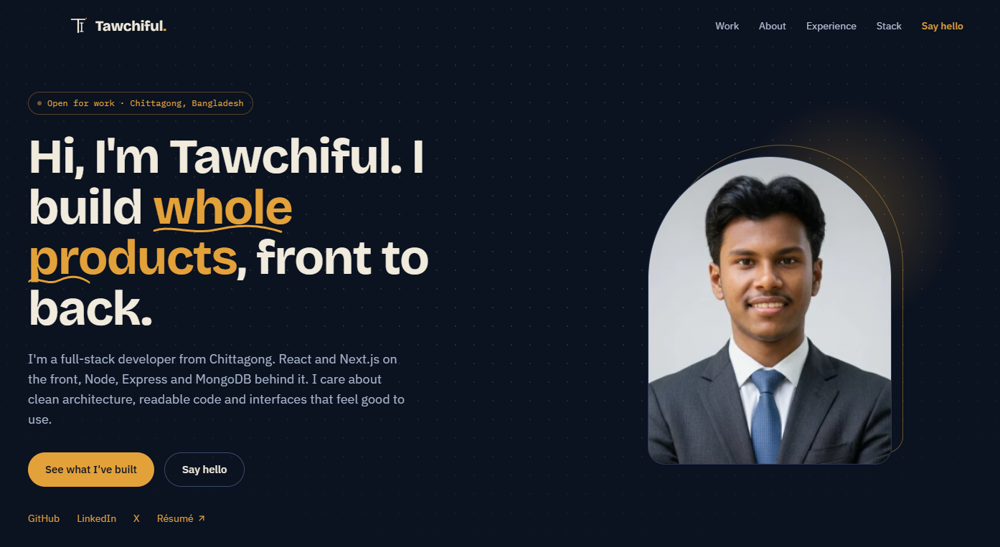

# Tawchiful Islam

A personal portfolio website with a built-in admin dashboard.

[Live Site](https://tawchif.vercel.app) · [GitHub](https://github.com/tawchifulislam) · [LinkedIn](https://linkedin.com/in/tawchiful-islam)

## Overview

A personal portfolio showcasing projects, experience, and skills. Manage all website content, including text, images, and projects, through a private admin dashboard without editing code.

## Key Features

| Feature | Description |
| --- | --- |
| Admin Dashboard | Manage website sections, images, and projects |
| Instant Publishing | Publish changes to the live site within seconds |
| Contact Inbox | Store visitor messages with email alerts as backup |
| One-Click Restore | Restore the website to its original version |
| Security | Authenticated admin access and secure secret management |
| Performance & Accessibility | Fast loading, responsive design, keyboard accessibility, and social media previews |

## Details

| | |
| --- | --- |
| Sections | Hero, Work (with project case studies), About, Experience, Tech Stack, Contact |
| Built With | Next.js, React, Tailwind CSS, Payload CMS, MongoDB Atlas |
| Hosting | Vercel |
| Technical Documentation | [docs/TECHNICAL.md](docs/TECHNICAL.md) |
